# NotHomeView

[](https://my.home-assistant.io/redirect/hacs_repository/?owner=gamergodggpwnd&repository=NotHomeView&category=plugin)

**Apple‑HomePad‑style frosted‑glass dashboards for Home Assistant – no YAML needed.**

NotHomeView gives you 22 good‑looking cards (thermostat, lights, scenes, music with a full "Now Playing" screen, cameras,
batteries, people, a Home Screen, TV, calendar, a screensaver settings popup and more), two themes (**HomeView Glass** and **HomeView Light**) and two
ready‑made example dashboards. Every card has a visual editor and a simple **Size** dropdown, so you build and change the
dashboard with clicks instead of code.


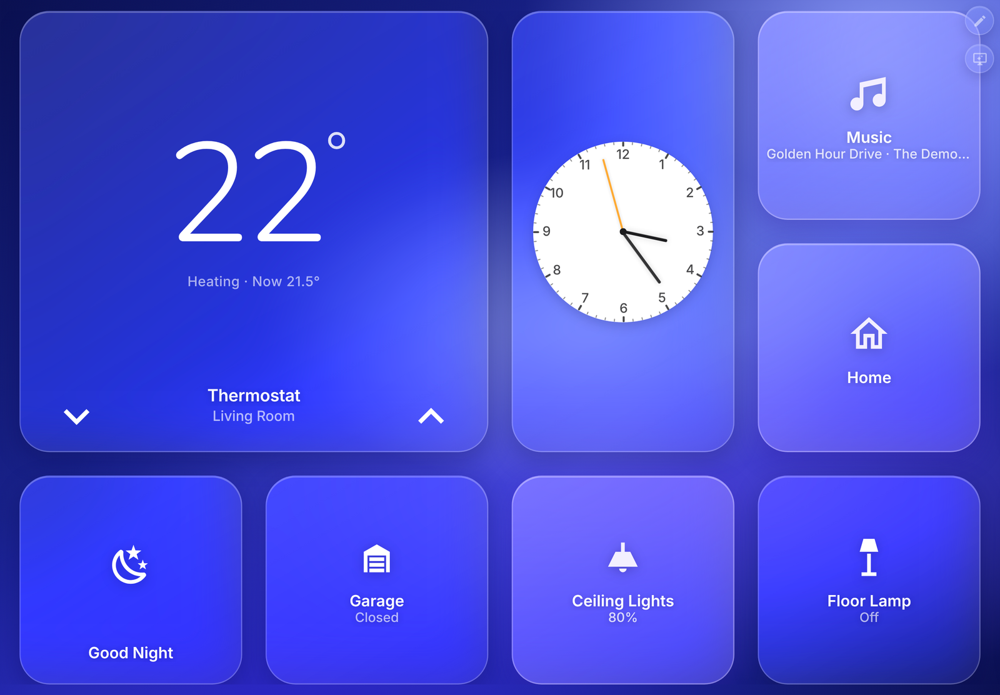

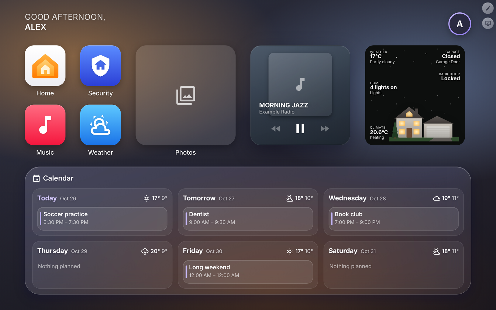

*The example Home Screen: greeting, app icons, Photos, Now Playing, the House tile and a week of calendar (sample data).*

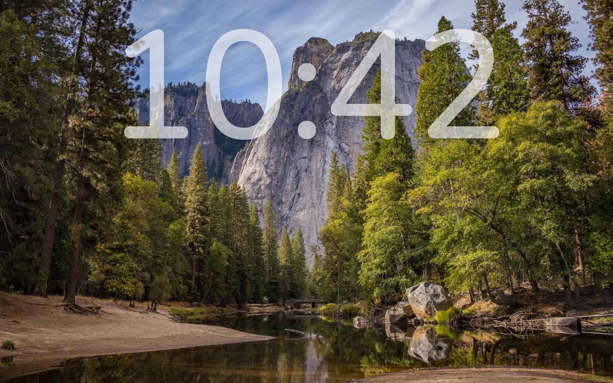

*The screensaver: Wallpanel photos with a big clock on top, set up from the Home Screen's screensaver button.*

| Light theme | Second page: camera, people, batteries |
|---|---|
| 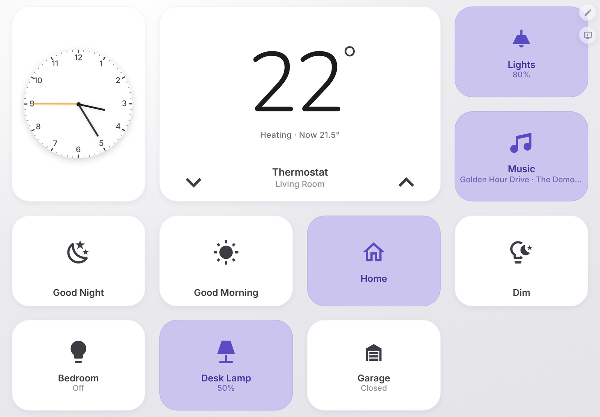 | 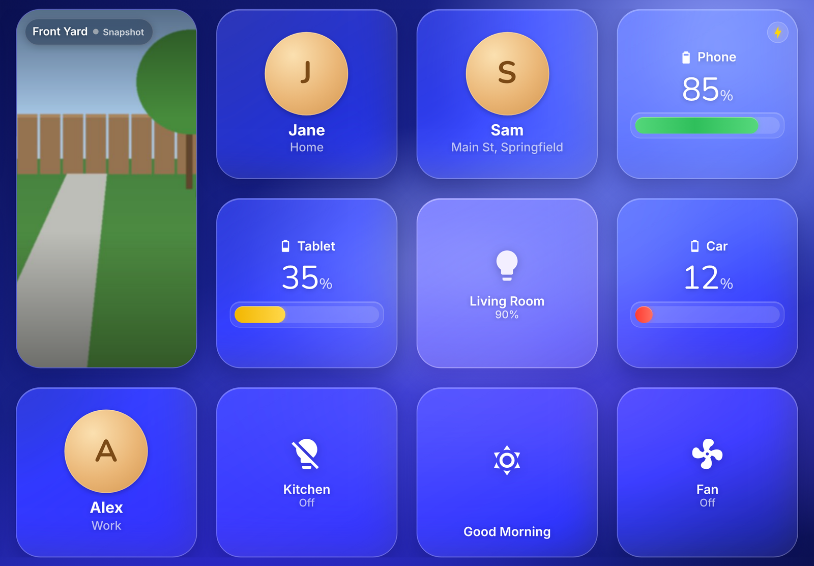 |

> In the card picker the cards are called **"NotHomeView …"**. In YAML their types are `custom:homeview-*`
> (for example `custom:homeview-light-card`).

**Upcoming Features**
- ✅ NotHomeView Home Screen - shortcuts, calendar, photos, all at a glance. *(shipped in v1.30.7)*
- ✅ TV Controls - allows user to control playback and navigation. *(shipped in v1.30.7: NotHomeView TV card)*
- ✅ Media uploader - allows user to upload photos directly to screensaver, no swiping out of the dashboard required. *(shipped in v1.30.7: "Add photos" in the photo gallery)*
- AI Assist support - allows user to access their preferred voice Assistant directly from dashboard. (must have assistant linked through plugin)
- Bug fixes and tweaks.

## Requirements

Install these through **[HACS](https://hacs.xyz/)**. Restart Home Assistant after installing the browser_mod integration, and
refresh the browser (clear its cache on phones and tablets) after installing frontend plugins. The NotHomeView cards themselves
(`dist/homeview-cards.js`) load without any other plugin; when a plugin is missing the cards fall back gracefully (for example a
tap opens Home Assistant's own more‑info dialog instead of a popup), and the Home Screen shows a small hint when the dashboard
asks for the screensaver but Wallpanel is missing.

**Required**

| Plugin | Type | What it's for |
|---|---|---|
| [Wallpanel](https://github.com/j-a-n/lovelace-wallpanel) · [open in HACS](https://my.home-assistant.io/redirect/hacs_repository/?owner=j-a-n&repository=lovelace-wallpanel&category=plugin) | Frontend | The photo / clock screensaver: Home Screen swipe‑away, the Edit Button's screensaver button and the Screensaver Settings card. |
| [card-mod](https://github.com/thomasloven/lovelace-card-mod) · [open in HACS](https://my.home-assistant.io/redirect/hacs_repository/?owner=thomasloven&repository=lovelace-card-mod&category=plugin) | Frontend | Applies the HomeView Glass / Light theme CSS (`themes/`), the example's sky background and the screensaver's clock setting. |
| [browser_mod](https://github.com/thomasloven/hass-browser_mod) · [open in HACS](https://my.home-assistant.io/redirect/hacs_repository/?owner=thomasloven&repository=hass-browser_mod&category=integration) | Integration (recommended) | The rounded popups: Garage chooser, Now Playing, TV, People map, camera large view, Lights / Climate. Without it taps open more‑info. |

**Optional**

| Plugin | Type | What it's for |
|---|---|---|
| [kiosk-mode](https://github.com/NemesisRE/kiosk-mode) · [open in HACS](https://my.home-assistant.io/redirect/hacs_repository/?owner=NemesisRE&repository=kiosk-mode&category=plugin) | Frontend | Hides the header and sidebar for a full‑screen wall panel (the Edit Button turns it off for editing with `?disable_km`). |
| [button-card](https://github.com/custom-cards/button-card) · [open in HACS](https://my.home-assistant.io/redirect/hacs_repository/?owner=custom-cards&repository=button-card&category=plugin) | Frontend | Only for the `homeview_styles` style helper (`button_card_templates/`), used by the example dashboards. |
| [layout-card](https://github.com/thomasloven/lovelace-layout-card) · [open in HACS](https://my.home-assistant.io/redirect/hacs_repository/?owner=thomasloven&repository=lovelace-layout-card&category=plugin) | Frontend | Only for the full‑height "band" example (`examples/homeview-example.yaml`, `custom:grid-layout`). Not needed for sections views. |
| [auto-entities](https://github.com/thomasloven/lovelace-auto-entities) · [open in HACS](https://my.home-assistant.io/redirect/hacs_repository/?owner=thomasloven&repository=lovelace-auto-entities&category=plugin) | Frontend | Only for the Lights / Climate popup contents in the example dashboards. |

Tested with Home Assistant 2026.10, card-mod 4.2.1, layout-card 2.4.7, button-card 7.0.1, browser_mod 3.3.0, kiosk-mode 15.0.0
and Wallpanel 4.67.2.

## What's new in v1.32.0 (next update, staged)

* **Animated weather header** (Home Screen card → *Layout & weather* → "Weather popup: animated sky header"). The Weather popup opens on an
  illustrated sky that follows the weather entity's live state: sunny, partly cloudy, cloudy, rain or snow, with a moonlit night sky after sunset.
  Thunderstorms add lightning flashes, fog adds haze, sleet mixes rain into the snow. CSS / SVG only, animated with transform and opacity
  (light enough for a wall tablet); no motion when the device asks for reduced motion. With the *Day* device-pages theme the forecast panels are white.

  | Home Assistant state | Sky |
  |---|---|
  | sunny, clear-night | Sunny (night: moon and stars) |
  | partlycloudy, windy, windy-variant | Partly cloudy (night: moon behind clouds) |
  | cloudy, fog, exceptional | Cloudy (fog adds haze) |
  | rainy, pouring, lightning, lightning-rainy, hail | Rain (pouring / storms are heavier; lightning flashes) |
  | snowy, snowy-rainy | Snow (snowy-rainy adds rain) |
  | anything else | Partly cloudy |

* **Assistant** (Home Screen card → *Assistant & timer*). A Siri-style popup with a glowing orb: tap the mic button beside the avatar (or an app
  with *What it does: Assistant*), speak, and the request goes to the Assist pipeline you pick (or Home Assistant's preferred one). It uses the
  microphone of the device showing the dashboard (the page must be opened over HTTPS, e.g. Home Assistant Cloud) and shows what was heard, the
  answer, and rows for lists, calendar items and the devices that were changed. You can always type instead. Day / Night look.
* **Timers that work in the browser**: "set a timer for 15 minutes", "set a pasta timer for 12 minutes", "pause / resume / cancel the timer",
  "how much time is left". Timers are recognised in the card, so they work with every pipeline and need no voice satellite. A full-screen countdown
  with a ring of ticks counts down; pause, cancel, +1 minute; at zero it flashes and plays a chime until you tap the screen. The timer keeps
  running after a reload, and a small pill on the Home Screen brings it back.
* **Add album link from the gallery**: the gallery's *Add photos* button opens a small menu: *Upload photos* or *Add album link*. Paste a
  Google Photos, iCloud or OneDrive link, see it checked (✓ / ⚠), tap *Save*: the Home Screen card's photo source becomes *Album link*
  (editable afterwards in the visual editor). With an album set, the menu offers *Change album link* and *Use media folder instead*. Admins only.
* **Now Playing tile opens the Music sheet**: tap the artwork or title of a Now Playing tile on the Home Screen to open the full player (the buttons on the tile still just control playback).
* **Arrange mode** (admins): long-press a room page to move, resize, duplicate, delete or edit tiles right on the dashboard, without Home Assistant's edit mode. Tap a tile for its ⋯ menu, hold and drag it to move it, drag its corner to resize it (snaps to 2 × 3, 2 × 6, 4 × 6 and 4 × 3 Tall), slide sideways to reach the page's other screens, then **Done** to save (or **Cancel**). `arrange: false` on the Page Grid turns it off. Long-press the Home Screen for the same on the hub (apps, Photos and extra tiles; tiles there are one tile or two wide).
* **Easy tile editing on room / device pages** (admins only). In the dashboard's edit mode every tile of a Page Grid has the same controls: tap it for the ⋯ menu (Edit opens that tile's own editor, Move earlier / later, Duplicate, Delete with a confirmation),
  hold and drag to move it onto another tile's spot (also to another page: hold at the edge), drag the corner to resize, slide sideways for the next screen. Works with a finger on iPad / iPhone and with the mouse; saved when you tap Done.
* **Edit pencil in popups** (admins only). The NotHomeView popups (Photos viewer and gallery, Weather, Music, device pages shown as sheets,
  Assistant, timer, camera / people large views, Rooms) show a pencil beside the ✕. It opens the visual editor of the card the popup belongs to
  (the Home Screen card, or the Page Grid on the tile you came from); a device page opens in edit mode. Turn it off with
  *Edit pencil next to ✕ in popups* on the Home Screen card (`popup_edit: false`).
* **Album links as a photo source** (Home Screen card → *Photos & background* → *Photo source* = *Album link*; screensaver: *Photos from* =
  *Album link*). Show a shared Google Photos, iCloud shared album or OneDrive album instead of the media folder. The editor detects the
  provider and checks the link; the list refreshes every 6 hours, shuffles with *Order = Random* and falls back to the media folder on errors.
  Google Photos and iCloud (and the screensaver) need the small optional helper integration in `custom_components/nothomeview_albums`;
  OneDrive works on the Photos tile without it. Details and limits: [docs/album-links.md](docs/album-links.md).

| Option | Default | Meaning |
|---|---|---|
| `weather_sky_header` | `false` | Animated sky header in the Weather popup |
| `assistant_enabled` | `false` | Assistant on this Home Screen |
| `assistant_pipeline` | `preferred` | Assist pipeline id (the editor lists your pipelines) |
| `assistant_button` | `true` | Mic button beside the avatar |
| `assistant_theme` | `same` | `same` (device pages theme), `day`, `night` or `auto` |
| `assistant_auto_listen` | `true` | Start listening as soon as it opens |
| `assistant_speak` | `true` | Play the spoken reply (the pipeline's text-to-speech) |
| `assistant_orb` | `true` | The mic shows only a floating animated orb near the top (no blur over the dashboard); tap the orb for the chat |
| `assistant_continue` | `true` | Keep listening until dismissed: after every reply the mic opens again in the same conversation |
| `assistant_dismiss_phrases` | `thank you, thanks, …, I'm done` | Comma-separated phrases that end the conversation when they are (almost) the whole utterance; not sent to the assistant |
| `assistant_silence_timeout` | `5` | Seconds the re-opened mic waits for you to start speaking; nothing said at all = the assistant closes |
| `assistant_end_of_speech_pause` | `2` | Seconds of quiet (1–5) after you start speaking before the request is sent; shorter pauses while you think keep recording into the same request |
| `assistant_history_retention` | `forever` | Chat history kept in the browser: `forever`, `1d`, `7d`, `14d`, `30d` (each device can choose its own / clear it in the assistant's settings) |
| `assistant_quiet_volume_entity` | `''` | Quiet mode *Auto*: the device's volume sensor (percent or 0–1); quiet under `assistant_quiet_volume_below` |
| `assistant_quiet_volume_below` | `5` | Quiet mode *Auto*: volume threshold in % |
| `assistant_quiet_focus_entity` | `''` | Quiet mode *Auto*: a Focus / Do Not Disturb sensor; quiet while it is on |
| `assistant_quiet_start` / `assistant_quiet_end` | `23:30` / `10:00` | Quiet mode *Auto*: quiet hours, used when no volume sensor is set or it isn't reporting |
| `timer_sound` | `true` | Chime when a timer ends |
| `popup_edit` | `true` | Edit pencil next to ✕ in popups (admins only) |
| `photo_source_mode` | `media` | `media` (media folder, `photo_source`) or `album` (`photo_album_url`) |
| `photo_album_url` | `''` | Shared album link (Google Photos, iCloud, OneDrive) |

Quiet mode is chosen on each device (Off / On / Auto) with the **Quiet** button in the assistant's chat header and kept in that browser (localStorage). In quiet mode the reply is not spoken: your words and the answer appear as a glass caption under the orb.

Microphone notes: browsers only allow the microphone on HTTPS pages. In the Home Assistant Companion app and kiosk browsers, the app itself also needs
microphone permission (Android: app settings → Permissions → Microphone; Fully Kiosk: enable microphone access). If access is blocked, the popup
says so and typing still works.

## What's new in v1.31.0: first-run setup

| Asked once (Day) | Asked once (Night) | Done |
|---|---|---|
| 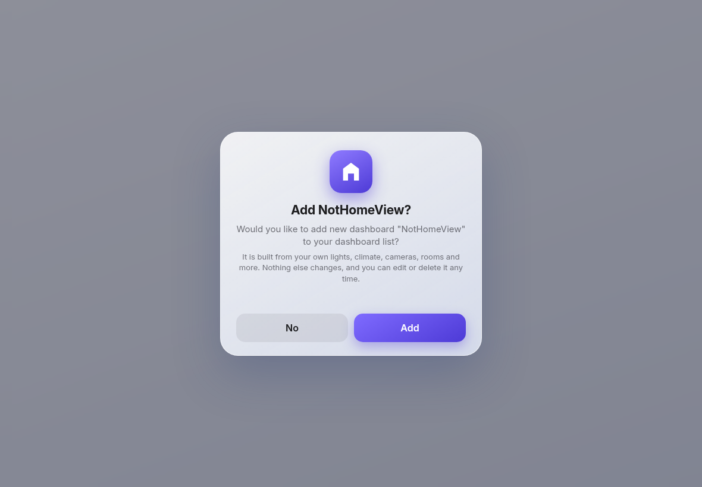 | 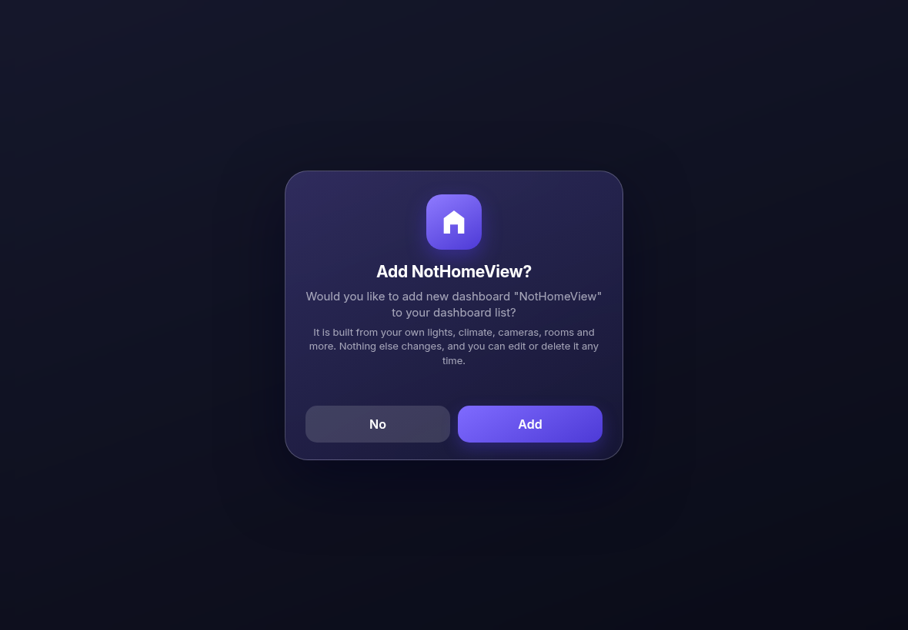 | 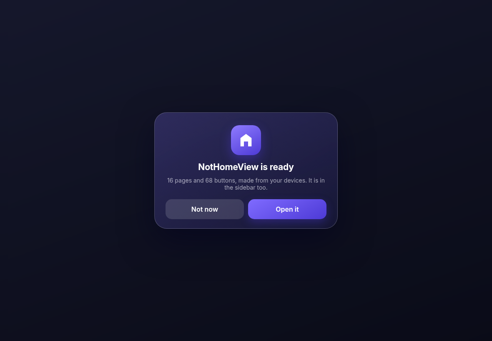 |

After you install NotHomeView and open any dashboard as an **administrator**, a small glass dialog asks:
*Would you like to add new dashboard "NotHomeView" to your dashboard list?*

* **Add** creates a new dashboard called **NotHomeView** (sidebar and *Settings › Dashboards*, address `/nothome-view`,
  or `/nothome-view-2` … when that one is taken) and fills it for you, laid out like the example dashboard:
  * a **Home Screen**: greeting with your name and avatar, four app icons (Home plus Security, Music and Weather when you
    have them), a Photos tile, Now Playing, the new **House** tile and a full-width Calendar with the weather (a soft
    wallpaper is shown until you add photos);
  * a **Home** page (thermostat, clock, garage, lights, music, scenes, calendar, TV, camera, people, locks, rooms) and pages
    for **Lights, Climate** (thermostats, fans, temperature / humidity), **Security** (cameras, alarm, locks, door / window /
    motion sensors), **Media, Garage / covers, Calendar** and **Rooms** (one page per area), each with the chips row on top
    and big glass tiles that follow the Night / Day / Auto theme;
  * the tiles come from your own entities, grouped by type and area. Hidden, disabled, unavailable and
    configuration / diagnostic entities are left out, and a page with nothing on it is not added;
  * it only uses NotHomeView cards and Home Assistant's own cards, so it works without browser_mod, Wallpanel, card-mod or
    button-card (install them later for the popups and the screensaver).

  When it is done you can open it straight away. Your other dashboards are not changed. Edit or delete it like any dashboard.
* **No** is remembered (in this browser and in your Home Assistant user profile), so you are not asked again.

The dialog is **never** shown to non-admin users, on wall tablets / kiosk screens (kiosk-mode, `?kiosk`, hidden sidebar,
Fully Kiosk, Wallpanel running), or when a NotHomeView dashboard already exists (any dashboard named NotHomeView, or any
dashboard that already uses the Home Screen or Page Grid card).

**Changed your mind?** Edit a *NotHomeView Hub* (Home Screen) card and press **Create NotHomeView dashboard** at the bottom
of its editor, or open the browser console (F12) on any dashboard and run `NotHomeView.setup()`.
`NotHomeView.dryRun()` returns the dashboard it would create (as JSON) without saving anything, and
`NotHomeView.resetSetup()` forgets your earlier answer.

| Generated Home Screen | Generated Home page (Night) | Generated Lights page (Day) |
|---|---|---|
| 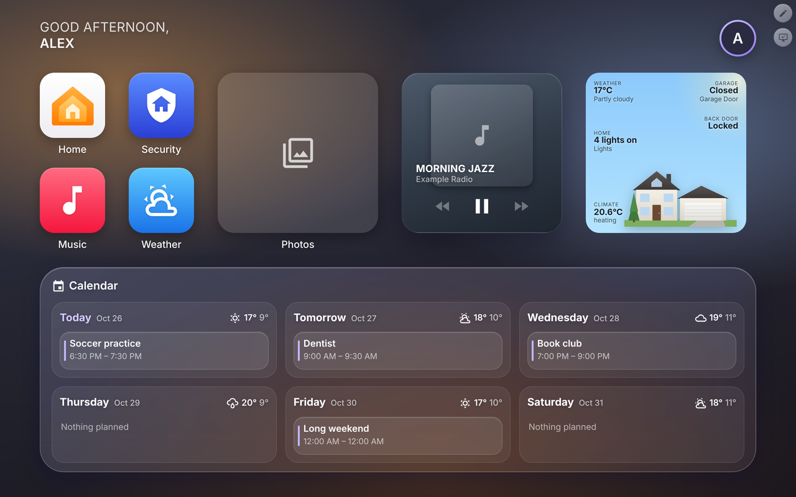 | 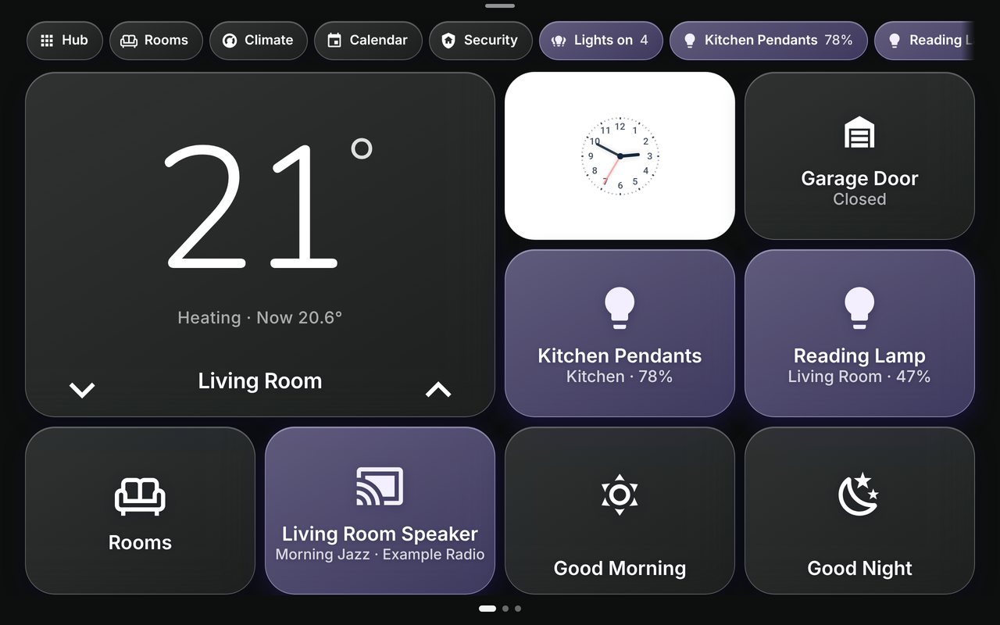 | 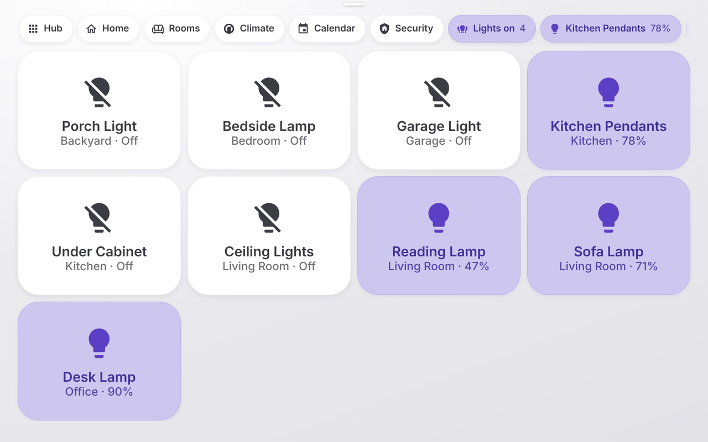 |

| Climate (Night) | Security (Day) | Home Screen on a phone |
|---|---|---|
| 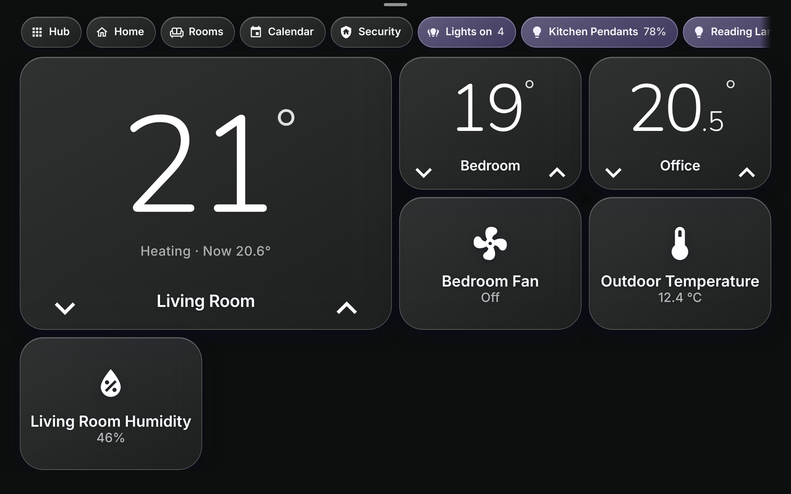 | 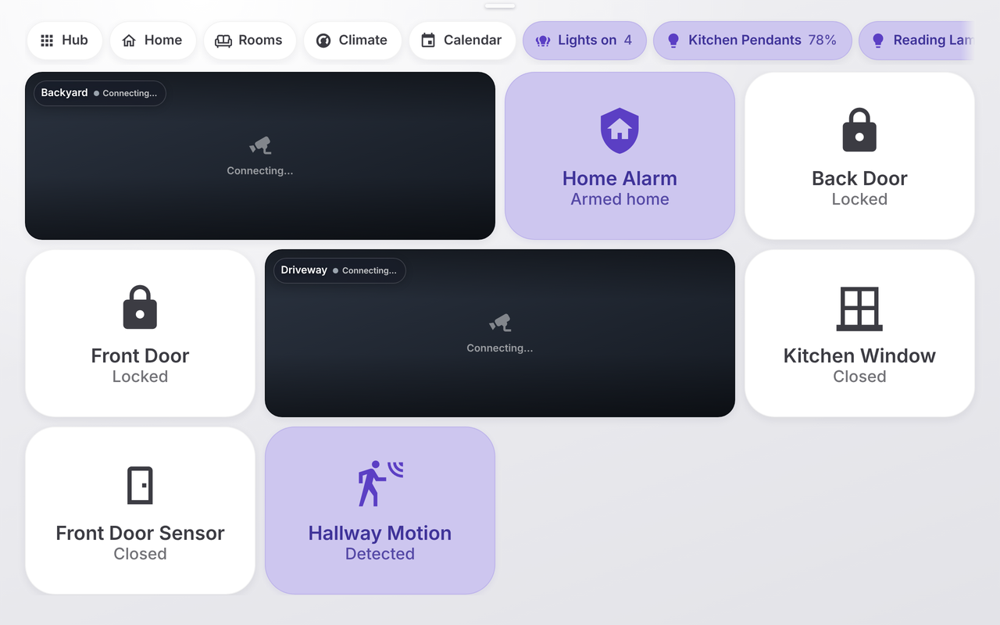 | 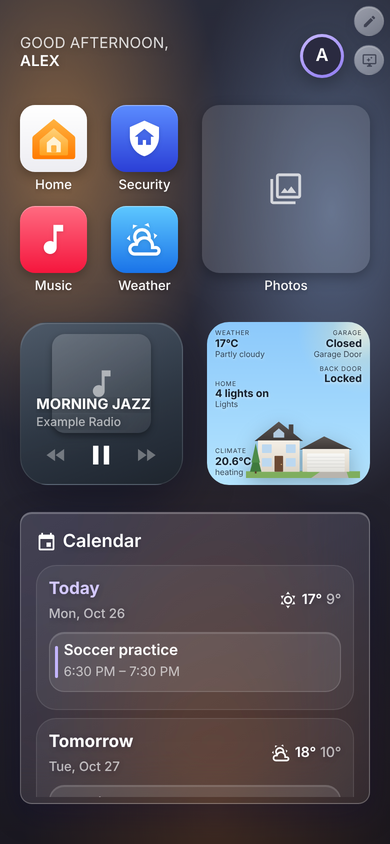 |

Also new in this release (used by the generated dashboard, available to everyone):

* **NotHomeView House** card (`custom:homeview-house-card`): a drawn house with labels for `weather`, `garage`, `lights`
  (a list; shows how many are on, `lights_path` opens a page), `climate` and `lock`. Only the labels you set are shown. The
  windows light up when lights are on after dark and the garage door follows its state. Put it in a Home Screen tile with
  *Sky background* on for the live sky behind it.
* Home Screen card: `wallpaper` (any CSS background, shown when there are no photos) and `full_width: true` (also on the
  Page Grid card): the page uses the whole window without the example's style template.
* Chips card: `count_entities` on a chip shows how many of those entities are on (a "Lights on" chip without a helper sensor).

*(Screenshots made with sample data.)*

## What's new in v1.30.7

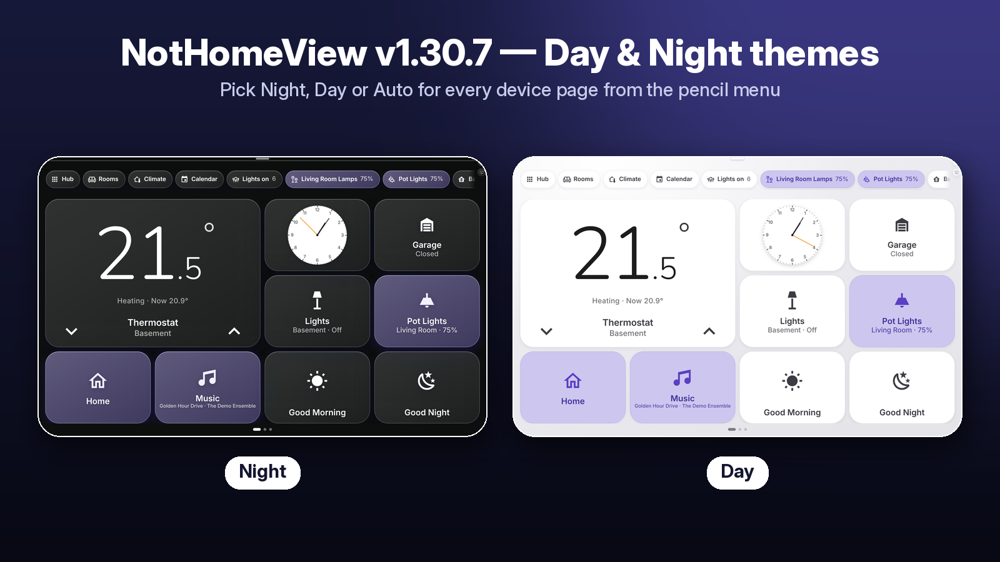

From this release the GitHub version follows the card bundle's own version (the browser console shows `HOMEVIEW-CARDS 1.30.7`).
Full list: [CHANGELOG.md](CHANGELOG.md).

**New features**

* **Device pages theme: Night / Day / Auto.** Pick it from the ✏️ pencil menu or in the Home Screen card's editor (details below).
* **NotHomeView Home Screen** (picker name *NotHomeView Hub*): greeting, app icons, Photos widget, Now Playing, calendar and weather,
  over a blurred photo background that stays **frozen** while the Home Screen is showing.
* **Screensaver pauses on the Home Screen**: it starts again only when it is enabled and the Home Screen is closed / swiped away.
* **Photo viewer** with **Previous / Next** (and swipe), and a **View Gallery** popup with **Add photos** (upload straight into the
  screensaver folder).
* **Garage chooser popup**: open door 1, door 2 or both, with the live state of each door (NotHomeView Garage card, *chooser* on).
* **Wallpanel‑missing hint**: the Home Screen and the card editors tell you when the screensaver needs Wallpanel.
* New cards: Home Screen (Hub), Chips, Page Grid (+ Page Break), TV and TV Player, Calendar, Garage Chooser.

**Bug fixes / performance**

* The **Rooms popup** now opens in front of a device page that is shown as a sheet; **Escape** closes only the top popup.
* Smoother **25 s photo rotation**: the next photo is downloaded and decoded before it is shown.
* Faster gallery opening and Previous / Next: a small download queue, decoded‑image cache and thumbnails.
* The default background blur now scales with the **transparency** slider.
* Swiping the Home Screen away can no longer start a screensaver that is turned off.
* The **Day** theme also applies to device pages opened as sheets from the Home Screen.

| Pencil menu | Home Screen | Garage chooser |
|---|---|---|
| 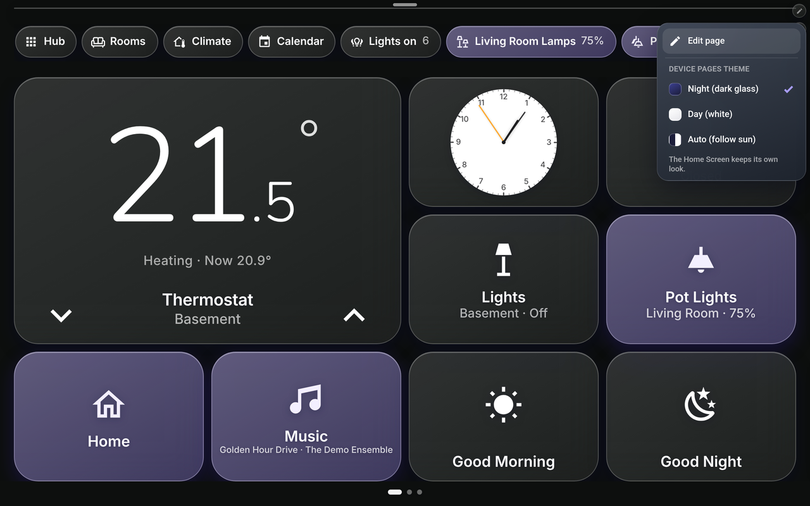 | 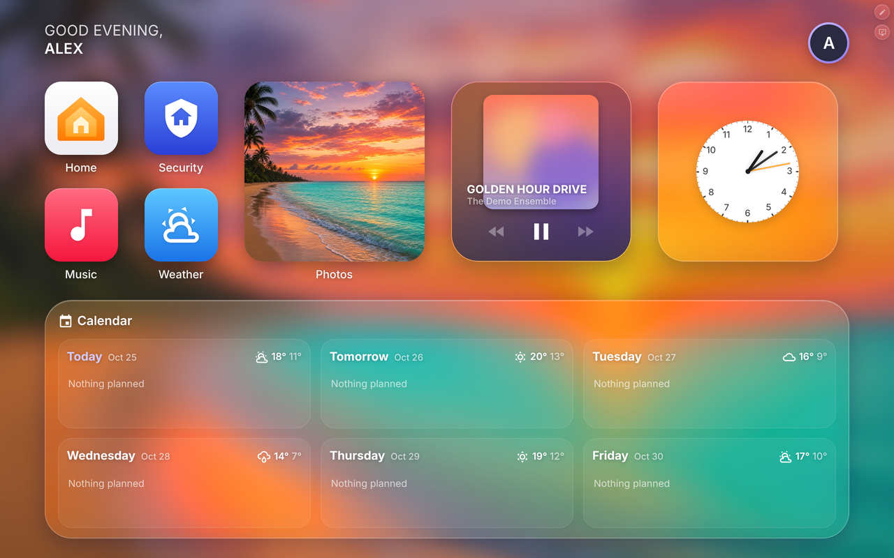 | 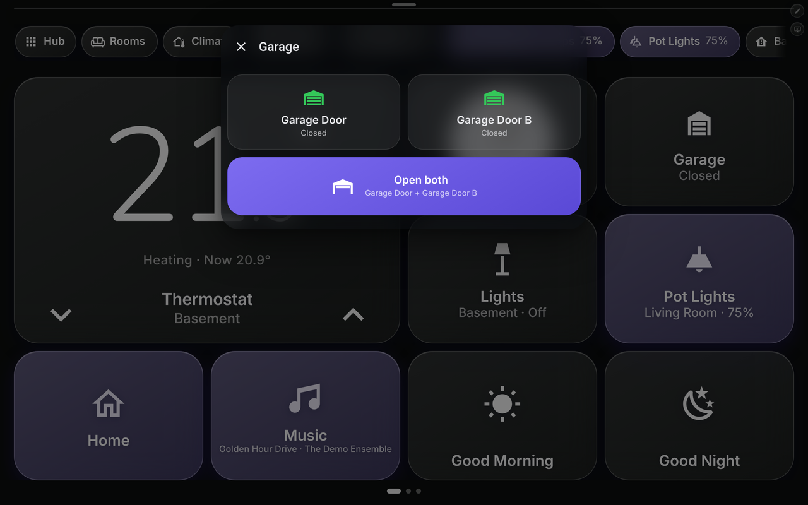 |

| Photo viewer and gallery | Rooms popup (Day theme) |
|---|---|
| 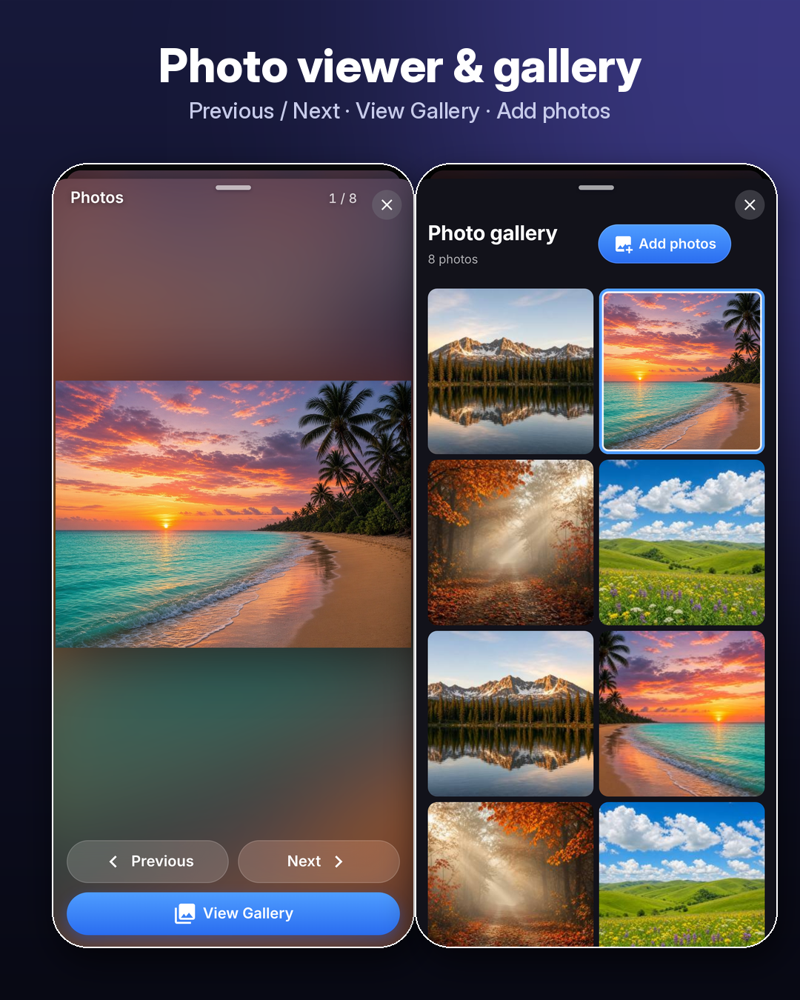 | 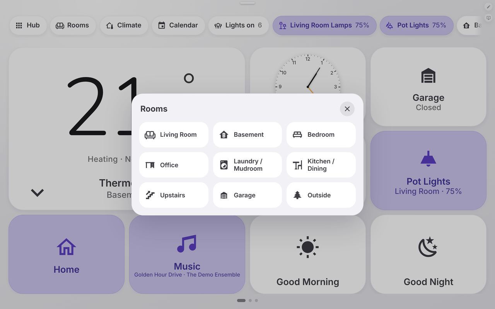 |

## Device pages theme (Night / Day / Auto)

The *device pages* are the views with the button tiles (Page Grid, tiles and their popups such as the garage chooser).
They can use one of three looks; the Home Screen and its photo sheets always keep their own look.

* **Night** (default): the dark glass look.
* **Day**: white tiles on a light grey page.
* **Auto**: follows the sun (`sun.sun`): Day while the sun is up, Night after sunset.

Two ways to choose it (admins only; the dashboard must be in storage mode, not YAML):

1. **Pencil menu**: tap the ✏️ pencil (NotHomeView Edit Button) → under *Device pages theme* pick **Night (dark glass)**,
   **Day (white)** or **Auto (follow sun)**. It's saved at once for everyone using the dashboard.
2. **Home Screen card editor**: edit the NotHomeView Home Screen (Hub) card and set **Theme**. In YAML this is the `theme:`
   option of the `custom:homeview-hub-card` (`day` or `auto`; no key = Night).

A single NotHomeView Page Grid can override it for its own page; by default it uses *Same as all device pages*.
The dashboard needs a Home Screen card for the pencil menu to save the theme.

## Contents

* [Card gallery](#card-gallery)
* [Requirements](#requirements)
* [What's new in v1.30.7](#whats-new-in-v1307)
* [Device pages theme (Night / Day / Auto)](#device-pages-theme-night--day--auto)
* [Install (step by step)](#install-step-by-step)
* [Walkthrough: add and edit cards](#walkthrough-add-and-edit-cards)
* [Walkthrough: tile sizes and the Layout tab](#walkthrough-tile-sizes-and-the-layout-tab)
* [Walkthrough: horizontal pages](#walkthrough-horizontal-pages)
* [Walkthrough: screensaver settings](#walkthrough-screensaver-settings)
* [Card reference](#card-reference) (all options, for advanced users)
* [Troubleshooting](#troubleshooting)
* [Repository layout](#repository-layout)

## Card gallery

| Card (picker name) | Type | What it does | Sizes |
|---|---|---|---|
| NotHomeView Thermostat | `custom:homeview-thermostat-card` | big set‑point, ± chevrons (0.5° steps), mode and current temperature | 2×3, 2×6, 4×6 (compact layout at 2 rows) |
| NotHomeView Light | `custom:homeview-light-card` | tap toggles, shows brightness %, hold for more‑info | 2×3, 2×6, 4×6 |
| NotHomeView Entity | `custom:homeview-entity-card` | any entity as a tile: icon, name, state or attribute | 2×3, 2×6, 4×6 |
| NotHomeView Group | `custom:homeview-group-card` | several lights/switches: "3 on", tap toggles all | 2×3, 2×6, 4×6 |
| NotHomeView Scene | `custom:homeview-scene-card` | scene / script button with optional confirmation | 2×3, 2×6, 4×6 |
| NotHomeView Garage | `custom:homeview-garage-card` | garage door / cover: open or close, with confirmation | 2×3, 2×6, 4×6 |
| NotHomeView Music | `custom:homeview-music-card` | shows what's playing; tap opens the Now Playing popup | 2×3, 2×6, 4×6 |
| NotHomeView Now Playing | `custom:homeview-now-playing-card` | Apple‑style player: artwork, progress, controls, volume, speaker picker | 2×3 up to full width (compact under ~260 px) |
| NotHomeView Navigation | `custom:homeview-nav-card` | go to another view, or switch between two views | 2×3, 2×6, 4×6 |
| NotHomeView Camera | `custom:homeview-camera-card` | live or snapshot camera tile; tap = large view | 2×3, 2×6, 4×6, **4×3 Tall** |
| NotHomeView Battery | `custom:homeview-battery-card` | glass bar with a big %, green / yellow / red, bolt while charging | 2×3, 2×6, 4×6 |
| NotHomeView People | `custom:homeview-person-card` | Find‑My‑style avatar, zone or street + city; tap = map | 2×3, 4×6 |
| NotHomeView Edit Button | `custom:homeview-edit-button-card` | small glass pencil in a corner (opens edit mode) + screensaver button | no grid space |
| NotHomeView Hub (Home Screen) | `custom:homeview-hub-card` | launch page: greeting, app icons, Photos widget (viewer + gallery), Now Playing, calendar, weather, blurred photo background; holds the Device pages theme | full width |
| NotHomeView Chips | `custom:homeview-chips-card` | scrollable row of glass pills: light groups, thermostats, navigation, Rooms picker | full width |
| NotHomeView Page Grid | `custom:homeview-grid-card` | big tiles in swipeable pages sized to the screen (3 × 3 portrait, 3 × 4 landscape) | full width |
| NotHomeView Page Break | `custom:homeview-page-break` | inside a Page Grid: the next tile starts a new page | – |
| NotHomeView TV | `custom:homeview-tv-card` | TV tile; tap opens a TV popup with power, apps, TV switcher and remote | 2×3, 2×6, 4×6 |
| NotHomeView TV Player | `custom:homeview-tv-player-card` | the TV popup on its own: picture, transport, volume, D‑pad | any |
| NotHomeView Calendar | `custom:homeview-calendar-card` | upcoming events from your calendars with optional weather | any |
| NotHomeView Garage Chooser | `custom:homeview-garage-chooser-card` | popup content: two garage doors with Open door 1 / door 2 / both | popup |
| NotHomeView Screensaver Settings | `custom:homeview-screensaver-card` | friendly form for the Wallpanel screensaver (usually opened from the button) | popup |

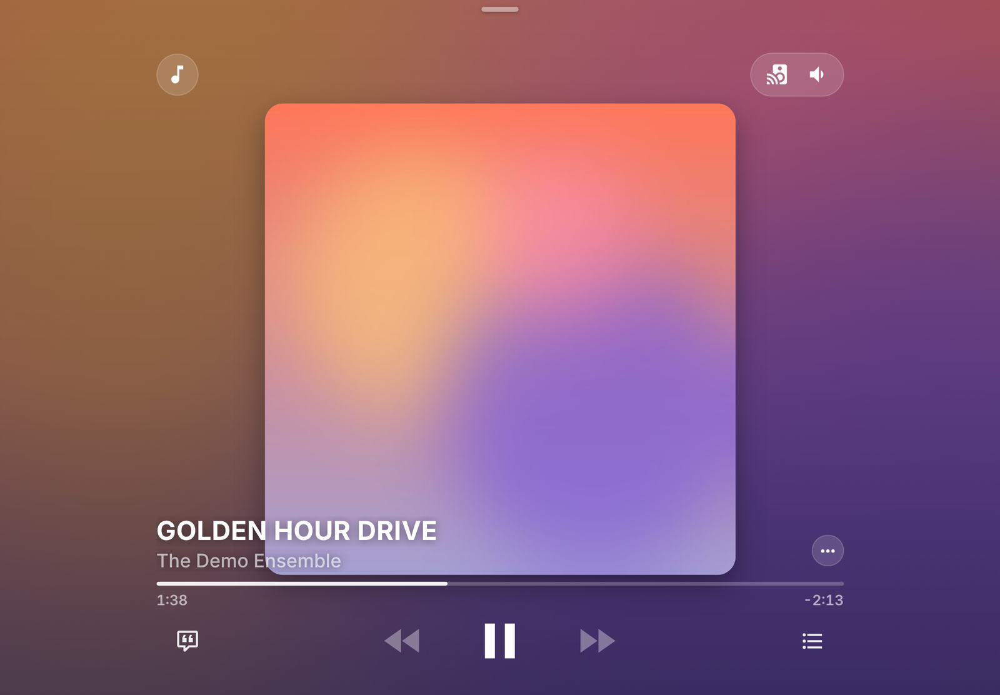

## What you need

See [Requirements](#requirements) above. browser_mod is an integration: after downloading it, restart Home Assistant and add it
under *Settings → Devices & services → Add integration → Browser Mod*.

## Install (step by step)

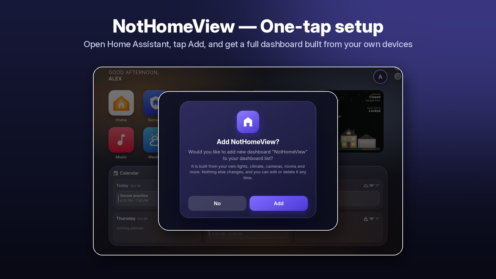

### 1. Add NotHomeView to HACS

One click (opens this repository in HACS):

[](https://my.home-assistant.io/redirect/hacs_repository/?owner=gamergodggpwnd&repository=NotHomeView&category=plugin)

Or add it manually as a custom repository:

1. Open **HACS**, click the **⋮** menu (top right) → **Custom repositories**.
2. Paste this repository's GitHub URL, choose the type **Dashboard** (called *Lovelace* or *Plugin* in older HACS) and click **Add**.
3. Search **NotHomeView** in HACS, open it and click **Download** (keep the latest version).
4. **Refresh the browser** (or close and reopen the Home Assistant app). On a wall tablet, reload that too.
5. Check the resource: *Settings → Dashboards → ⋮ → Resources*. You should see `/hacsfiles/…/homeview-cards.js`
   as a *JavaScript module*. If it's missing (or your dashboards are in YAML mode), click **Add resource** and add it yourself.

### 2. Install the other downloads

Download **Wallpanel**, **card-mod**, **browser_mod**, **button-card** and **auto-entities** for the example (and the other optional ones you want) from HACS, as listed in
[Requirements](#requirements). Restart Home Assistant once after browser_mod and add its integration, then refresh the browser.

### 3. Install the themes

HACS installs one thing per repository, so the themes are copied by hand (once):

1. Download `themes/homeview.yaml` from this repository and put it in your Home Assistant `config/themes/` folder
   (use the *File editor* or *Samba* add‑on; create the `themes` folder if it doesn't exist).
2. Make sure `configuration.yaml` contains:
   ```yaml
   frontend:
     themes: !include_dir_merge_named themes
   ```
3. Go to *Developer tools → Actions*, run **Frontend: Reload themes** (`frontend.reload_themes`).
4. You now have **HomeView Glass** and **HomeView Light** in your profile's theme list. You don't have to select them
   there: each dashboard view picks its theme (the examples already do: *Edit view → Theme*).

Can't copy files? See [Can't install theme files?](#cant-install-theme-files): the style helper alone gives the same look.

### 4. Create a dashboard (sections layout, recommended)

1. *Settings → Dashboards → **Add dashboard** → New dashboard from scratch*, give it a name (e.g. "Home") and open it.
2. Click the **✏️ pencil** (top right) → **⋮** → **Raw configuration editor**.
3. Delete everything, paste the content of `examples/homeview-example-sections.yaml` and click **Save**, then close the editor.
   This is the full NotHomeView layout: a Home Screen, a Home device page, Security, nine room pages, Lights On and Climate,
   with the **style helper** (the `button_card_templates:` block and one hidden "HomeView styles" card per view), both themes,
   the edit button and a screensaver config (Wallpanel `enabled: false` until you turn it on with the screensaver button).
4. Replace the example entities (`light.example_…`, `climate.example_…`, `person.example_alex`, …) with your own. No YAML
   needed: click a tile in edit mode, pick your entity in the **Entity** box and **Save** (see the next section). The example's
   navigation paths use the dashboard URL `nothomeview`: give your dashboard that URL, or replace `/nothomeview/` in the raw
   configuration editor with your dashboard's URL.
5. Click **Done**. On a wall tablet, open `/<your-dashboard>/main?kiosk` (kiosk‑mode) and, if you use Wallpanel,
   `?kiosk&wp_enabled=true`.

> Prefer the full‑height "band" layout with layout‑card? Paste `examples/homeview-example.yaml` instead.
>
> Building your own dashboard instead of the example? Paste `button_card_templates/homeview_styles.yaml` at the top of the raw
> configuration, set each view's theme to *HomeView Glass* or *HomeView Light*, and add one helper card per view:
> ```yaml
> type: custom:button-card
> template: homeview_styles
> variables: { theme: glass }   # or light
> ```

### Manual install (without HACS)

1. Copy `dist/homeview-cards.js` to `config/www/homeview-cards.js`.
2. *Settings → Dashboards → ⋮ → Resources → Add resource*: URL `/local/homeview-cards.js?v=1`, type **JavaScript module**.
3. Refresh the browser. After an update, copy the new file and change `?v=1` to `?v=2` (and so on) so browsers reload it.
4. Then follow steps 2–4 above.

## Walkthrough: add and edit cards

1. **Open edit mode.** Tap the small glass **✏️ pencil** in the top‑right corner of the dashboard (the NotHomeView Edit Button,
   visible to admins), or open the dashboard with `?disable_km&edit=1` at the end of the URL.

   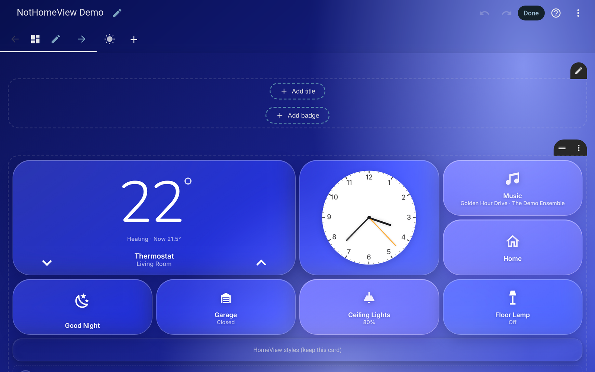

2. **Add a card.** Click the **+** box at the end of a section.

   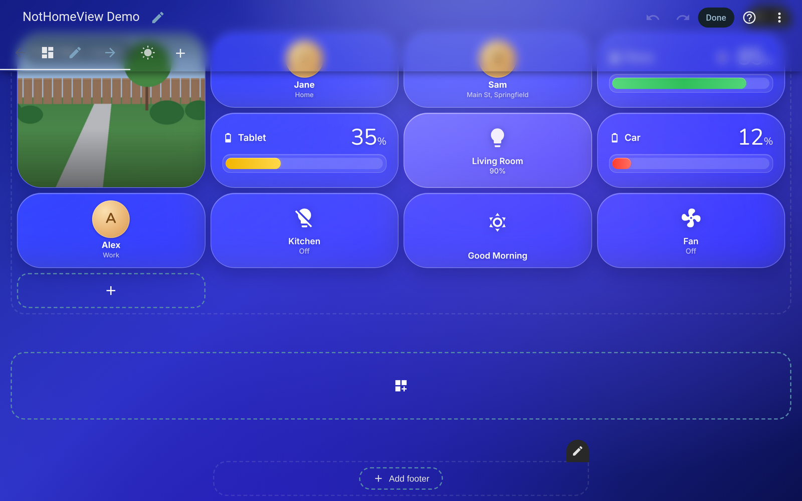

3. **Find the NotHomeView cards.** Switch to the **By card** tab and type **NotHomeView** in the search box.

   | Add to dashboard | Search "NotHomeView" |
   |---|---|
   | 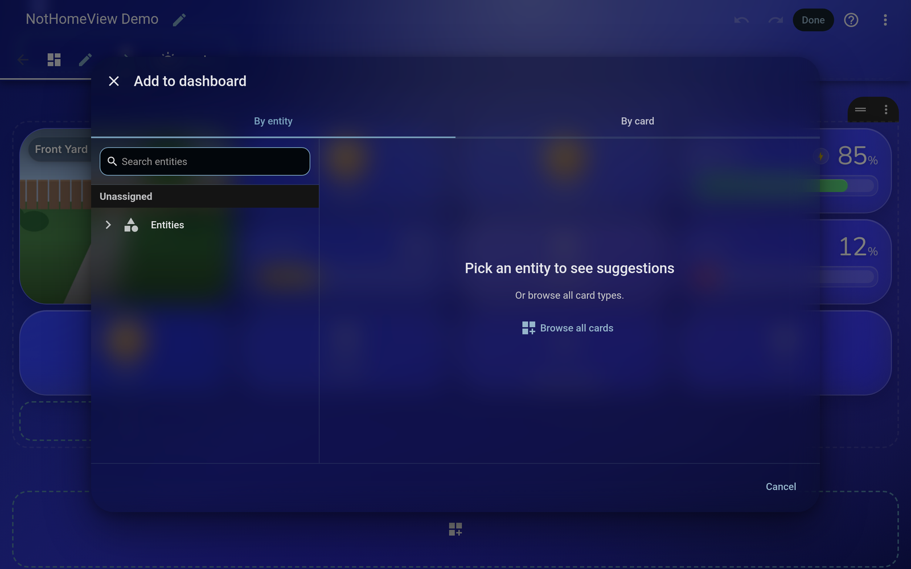 | 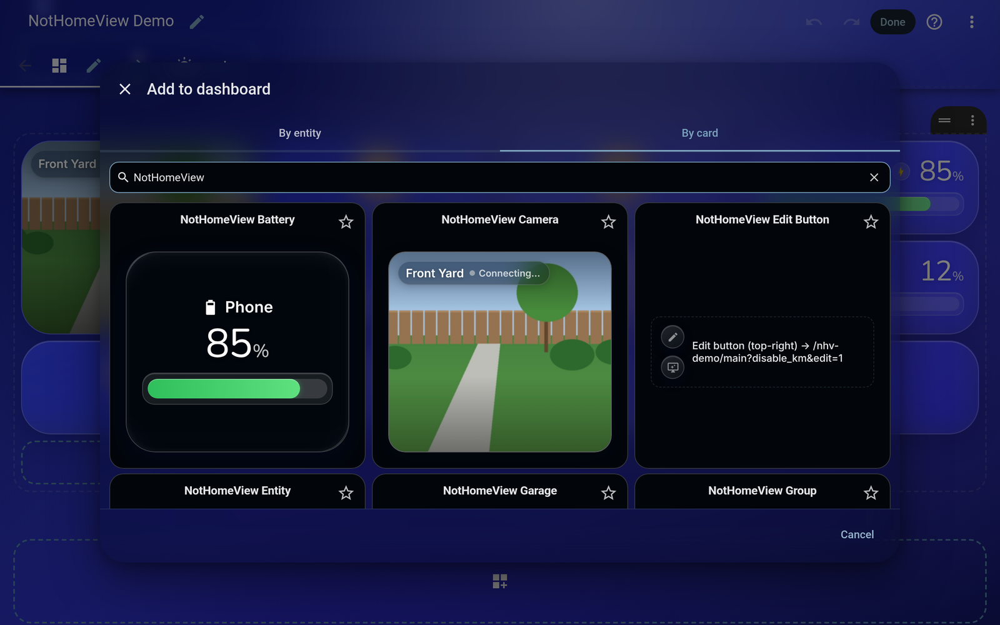 |

4. **Pick a card**, e.g. *NotHomeView Light*. The visual editor opens with a live preview on the right.

   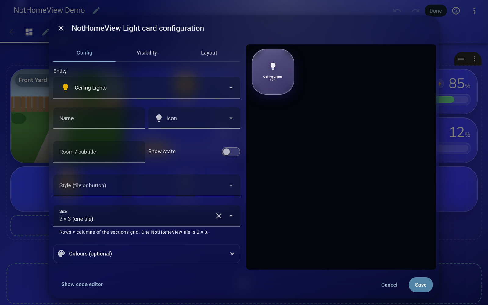

5. **Pick the entity.** Click the **Entity** box and choose your light (type to search).

   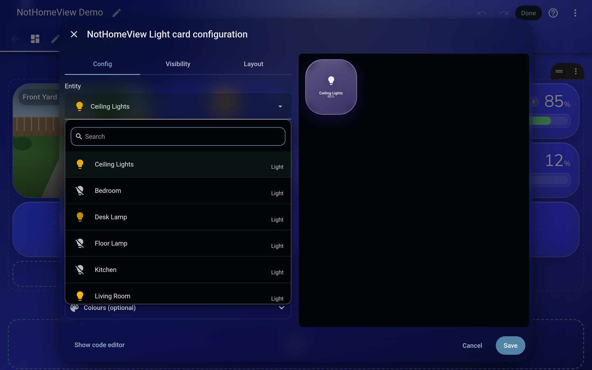

6. **Set the size** with the **Size** dropdown (see the next walkthrough), adjust name, icon, room / subtitle, style or colours
   if you like, then click **Save**.
7. **Move it.** In edit mode, drag a card by its body to a new spot in the grid; the other tiles move out of the way.
8. **Edit or remove later.** In edit mode click any card to open its editor again, or use its **⋮** menu to duplicate or delete it.
9. Click **Done** (top right) when you're finished.

## Walkthrough: tile sizes and the Layout tab

The sections grid has 12 small columns per section. **One NotHomeView tile is 3 columns × 2 rows** – four tiles side by side.
Sizes in the dropdown are written *rows × columns*:

| Size option | Rows × columns | Looks like |
|---|---|---|
| **2 × 3 (one tile)** | 2 × 3 | one normal tile |
| **2 × 6 (two tiles wide)** | 2 × 6 | a wide tile, two tiles across |
| **4 × 6 (2 tiles wide & tall)** | 4 × 6 | a big square, 2 × 2 tiles (e.g. the thermostat) |
| **4 × 3 Tall** (camera only) | 4 × 3 | one tile wide, two tiles tall – great for portrait cameras |
| **Custom (r × c)** | anything else | shown when the card was resized another way |

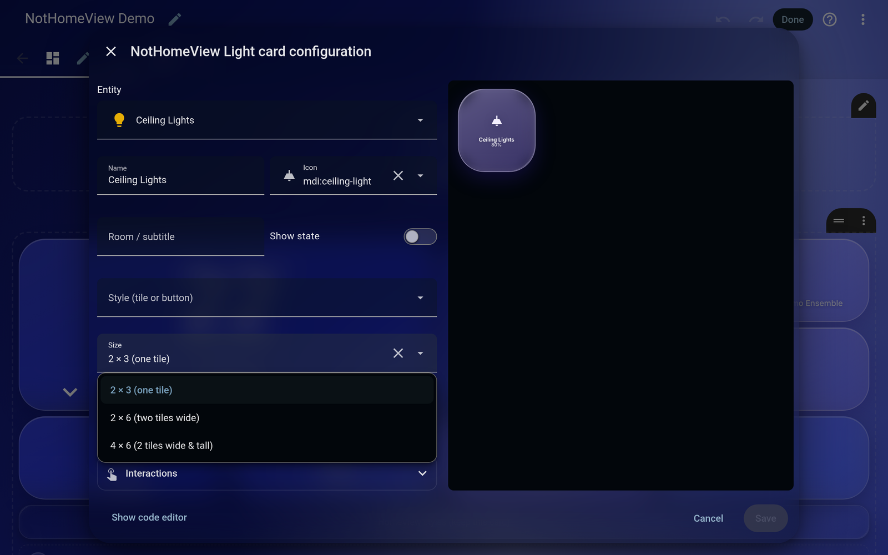

The camera card adds the **Tall** option:

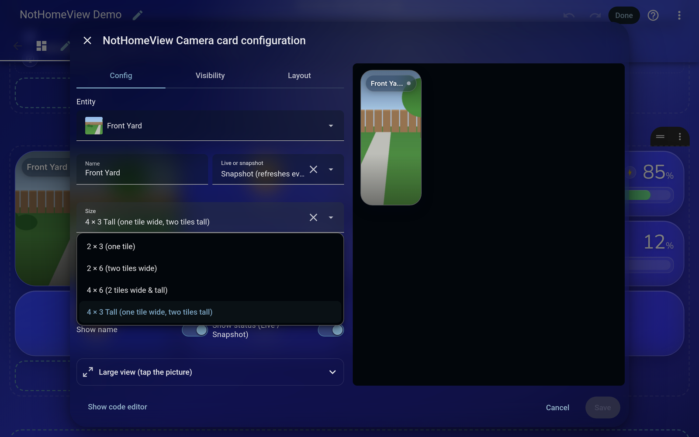

Picking a size writes the card's `grid_options` for you; the content scales with the tile (bigger icons and text, the
thermostat switches to a compact layout at 2 rows, Now Playing becomes a compact player when it's short). The People card
offers only 2 × 3 and 4 × 6.

**Layout tab.** For any other size, open the card editor's **Layout** tab (top of the editor) and drag the handles, or use
*Full width* / *Precise mode*. The Size dropdown then shows **Custom (r × c)**; pick a preset again at any time to go back.

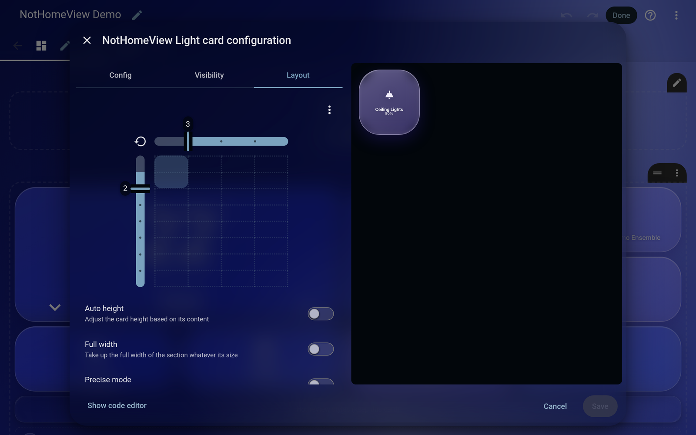

## Walkthrough: horizontal pages

On a sections view, the **first section fills the screen** and **every extra section becomes its own page to the right**.
Swipe (or scroll sideways) to move between pages; it snaps one page at a time, and the page you're on is remembered when the
screen updates.

1. In edit mode, scroll to the bottom of the view and click the **Create section** box (the dashed box with the grid icon,
   see the picture in *add and edit cards*).
2. Add cards to the new section with its **+** box. In edit mode the sections are shown one after the other so you can drag
   cards between them.
3. Click **Done**: the new section is page 2. Rows keep the same height on every page, so tiles look the same everywhere.


The view needs the hidden *HomeView styles* helper card (the examples have it). Nothing else to configure.

## Walkthrough: screensaver settings

If [Wallpanel](https://github.com/j-a-n/lovelace-wallpanel) is installed, a second glass button sits **right under the
edit pencil**. It's visible to admins only.

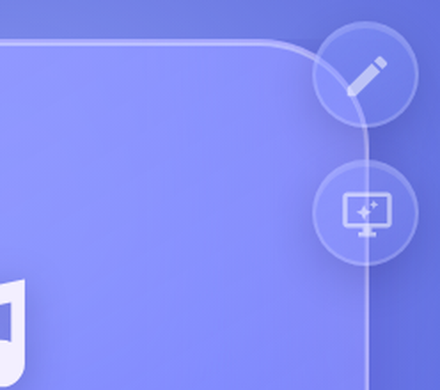

Tap it to open the **Screensaver** popup for this dashboard. Close it with **✕** or by swiping down.

| General | Photos |
|---|---|
| 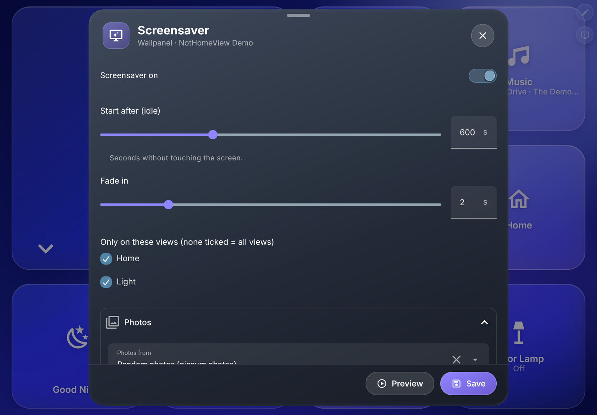 | 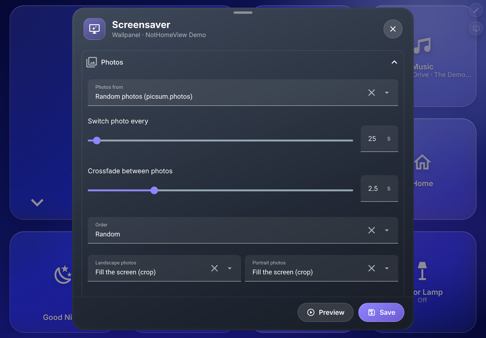 |
| **Clock** | **Screen & behaviour** |
| 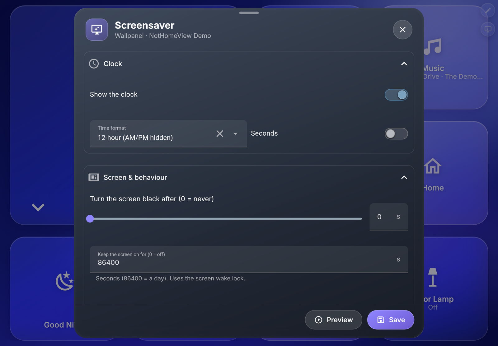 | 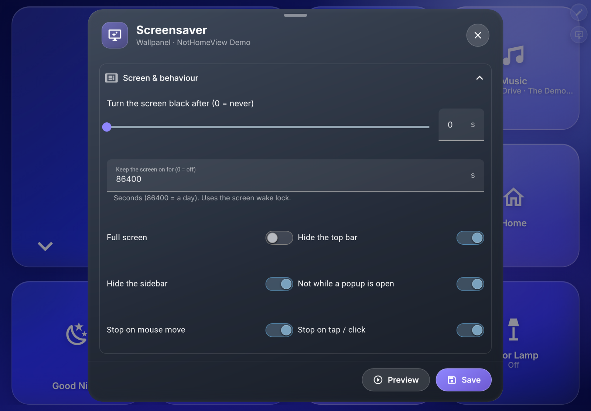 |

* **General** – *Screensaver on*, *Start after (idle)* in seconds, *Fade in*, and which views it runs on (none ticked = all views).
* **Photos** – *Photos from*: a **Media folder** (Home Assistant's *Media → My media*, e.g. `media-source://media_source/local/`;
  every photo in the folder is used), an **Album link** (Google Photos, iCloud or OneDrive; needs the
  [Album Links helper](docs/album-links.md)), a **Web address**, **Random photos** (picsum.photos), or **No photos (clock only)**.
  Then *Switch photo every*, *Crossfade*, *Order* (random / in order / random folder), how landscape and portrait photos fit,
  *Skip videos*, *Progress bar* and *Show photo info*.
* **Clock** – show or hide the clock, *12‑hour* or *24‑hour*, and seconds.
* **Screen & behaviour** – turn the screen black after a while, keep the screen on, full screen, hide the top bar / sidebar,
  don't start while a popup is open, and stop on mouse move or tap.

**Save** writes only the options you changed into the dashboard's `wallpanel:` settings (everything else stays as it was) and
Wallpanel uses them right away. **Preview** closes the popup and starts the screensaver now, with the *saved* settings – so
Save first if you changed something.

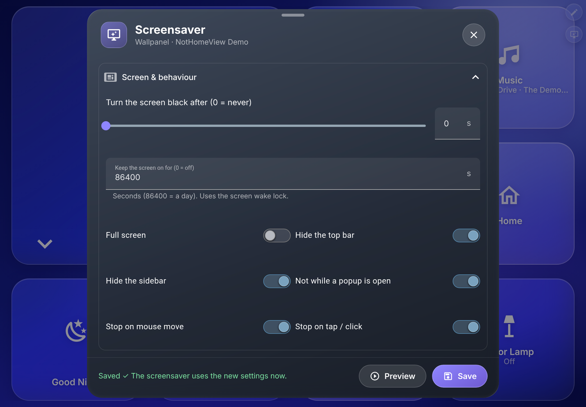

On a phone the same popup fills the screen:

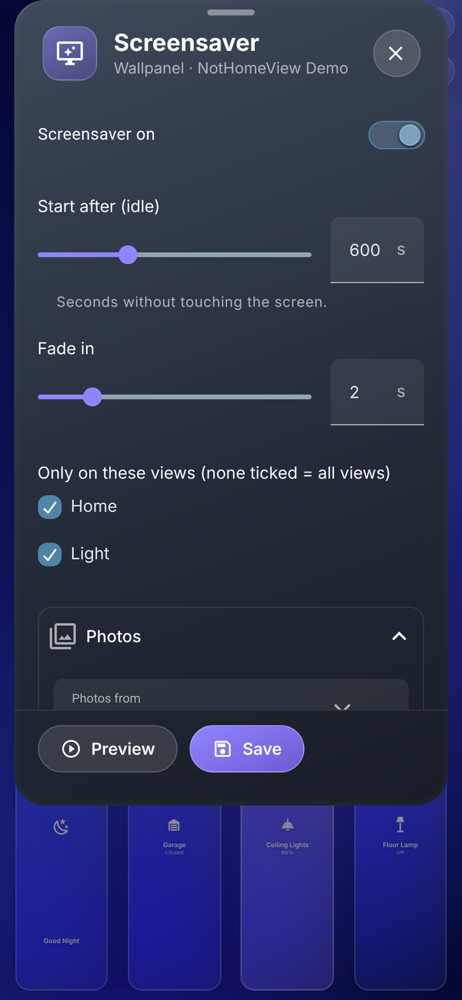

Don't want the button? Edit the Edit Button card (click its thin row in edit mode) and switch off
*Show the screensaver button*. *Show the edit pencil* hides the pencil the same way.

## Card reference

One file, `dist/homeview-cards.js`, adds 14 cards. All of them are in the card picker (search "NotHomeView"), have a full
visual editor, fill their grid cell and scale with it, and follow the HomeView theme colours (`--hv-*` variables) or
their own colour options.

| Card | Picker name | What it does |
|---|---|---|
| `custom:homeview-thermostat-card` | NotHomeView Thermostat | climate set‑point, mode and current temperature; chevrons ± `step` |
| `custom:homeview-entity-card` | NotHomeView Entity | any entity: icon, name, state / attribute / custom sub‑label |
| `custom:homeview-light-card` | NotHomeView Light | tap toggles, sub‑label = brightness % (optional `room · `), hold more‑info |
| `custom:homeview-garage-card` | NotHomeView Garage | cover: tap opens/closes, with optional confirmation; Open / Closed / Opening… |
| `custom:homeview-group-card` | NotHomeView Group | a list of entities or a group: "3 on" / "All off"; tap toggles all (or any action, e.g. a popup) |
| `custom:homeview-scene-card` | NotHomeView Scene | scene / script / automation button, optional confirmation; never shows as active |
| `custom:homeview-music-card` | NotHomeView Music | media player(s): shows what's playing; tap opens the Now Playing popup for its own speakers (or any tap action) |
| `custom:homeview-nav-card` | NotHomeView Navigation | navigate to a view, or toggle between two views; keeps `?kiosk&wp_enabled=true` |
| `custom:homeview-now-playing-card` | NotHomeView Now Playing | Apple‑style Now Playing panel: blurred artwork background, big art, title/artist, live progress, prev/play/next, volume and a speaker picker. Use as a card or as popup content |
| `custom:homeview-camera-card` | NotHomeView Camera | live camera tile (muted stream or snapshot) with name/status and optional glass state buttons; tap = large view (full screen or window, swipe down to close). Sizes 2×3, 2×6, 4×6 and 4×3 Tall |
| `custom:homeview-battery-card` | NotHomeView Battery | battery level as a rounded glass bar filled to the %, big % number and name; green 51–100 %, yellow 21–50 %, red ≤ 20 %; bolt top‑right while charging; no times, dates or axis. Sizes 2×3, 2×6, 4×6 |
| `custom:homeview-person-card` | NotHomeView People | Find My style person tile: round avatar (photo or initials) on a warm disc, optional status badge, bold name, location (zone, or street + city when away); tap = popup with a map. Sizes 2×3, 4×6 |
| `custom:homeview-edit-button-card` | NotHomeView Edit Button | small glass pencil fixed in a corner (takes no grid space); tap opens the dashboard editor with kiosk‑mode off. Below it, a screensaver button opens the Wallpanel settings popup |
| `custom:homeview-screensaver-card` | NotHomeView Screensaver Settings | friendly form for the dashboard's Wallpanel screensaver (normally opened from the edit button's screensaver button) |

The analog clock is the native `clock` card (styled by the theme), so it has no HomeView version.

**Card names.** In the card picker and editor the cards are called *NotHomeView …* (e.g. *NotHomeView Light*). Only the
display names changed: the types stay `custom:homeview-*`, so existing dashboards keep working.

### People card

`custom:homeview-person-card` ("NotHomeView People", 1.11) is a Find My style tile for a `person.*` entity: a large round avatar
(the person's picture, else their initials, else an icon) on a warm tan disc, a small badge on its top right, the name in bold and
the location below in grey. Everything is in the visual editor:

* **Person**, **Name** (empty = the person's name).
* **Location sensor (optional)**: shown when the person is away from every zone (street + city, e.g. *Main St, Springfield*).
  Empty = the phone's *Geocoded location* sensor (`sensor.*_geocoded_location` on one of the person's trackers), found
  automatically. In a zone it shows the zone (*Home*); with no address it shows the state (*Away*).
* **Badge entity (optional)**: the badge shows while it is on (e.g. a Focus / Do Not Disturb sensor; moon icon by default).
* **Size**: only *2 × 3 (one tile)* or *4 × 6 (2 tiles wide & tall)*.

Tap opens a browser_mod popup (same rounded style as the other cards, swipe down from the top or ✕ to close) with the avatar,
name, location, "Here / Away since …" and Home Assistant's own map card centred on the person. Without browser_mod, tap = more‑info.

### Battery card

`custom:homeview-battery-card` ("NotHomeView Battery", 1.9) shows a battery level the way a history graph shows a bar, without
any times, dates or axis: the name on top, a big % number, and an inner glass box holding a rounded bar filled to the level.
Colours: **green** 51–100 %, **yellow** 21–50 %, **red** 20 % and below. Unknown / unavailable shows "—" and an empty bar.
Tap = more‑info. Everything is in the visual editor:

* **Entity**: battery sensors first (device_class battery), but any numeric sensor works.
* **Name**, **Icon** (default: the entity's own battery icon), **Show the % number**, **Size** (2 × 3 / 2 × 6 / 4 × 6, like every card).
* **Charging entity (optional)**: a binary_sensor or sensor. While it is `on` / `charging` / `true` a bolt shows top‑right and
  the bar shimmers. Empty = found automatically on the same device: an entity with device_class `battery_charging`, else one
  named "Charging" (e.g. an EV integration's `sensor.car_charging`, state `charging`), else a phone's "Battery State" sensor.

```yaml
- type: custom:homeview-battery-card
  entity: sensor.phone_battery_level   # charging is detected from sensor.phone_battery_state
  name: Phone
```

**Size (every HomeView card).** Each card's editor has a **Size** dropdown: *2 × 3 (one tile)*, *2 × 6 (two tiles wide)* or
*4 × 6 (2 tiles wide & tall)*. These are rows × columns of the sections grid. Picking one writes the matching `grid_options`;
the dropdown always shows the card's current size, and *Custom (r × c)* when it was resized another way (e.g. HA's Layout tab).
The content scales with the card: tiles grow their icon and text, the thermostat switches to its compact layout at 2 rows tall,
and the Now Playing card becomes a compact player (art, title / artist, prev / play / next; art on the left when wide) below
about 260 px tall. (The edit button takes no grid space, so it has no Size.)

**Install:** see [Install (step by step)](#install-step-by-step).

No Home Assistant restart is needed; reload the browser / app afterwards.

Common options (all optional, all in the visual editor): `name`, `icon`, `layout` (`tile` or `button`), `tap_action`,
`hold_action`, and the colours `text_color`, `icon_color`, `accent_color` (active tint) and `background_color` (any CSS colour
or gradient). Examples:

```yaml
type: custom:homeview-thermostat-card
entity: climate.living_room
name: Thermostat
room: Living Room
step: 0.5            # 0.1 – 5
view_layout: {grid-column: span 2, grid-row: 1 / -1}
```
```yaml
type: custom:homeview-light-card
entity: light.kitchen
name: Kitchen
```
```yaml
type: custom:homeview-garage-card
entity: cover.garage_door
confirm: true
confirm_text: Open or close the garage door?
```
```yaml
type: custom:homeview-group-card
name: Downstairs
icon: mdi:lightbulb-group
entities: [light.kitchen, light.dining, light.hall]
```
```yaml
type: custom:homeview-scene-card
entity: scene.good_night
confirm_text: Run the Good Night scene?
```
```yaml
type: custom:homeview-music-card
entity: media_player.living_room     # default speaker
entities: [media_player.kitchen]     # "Speakers to switch between" in the editor; the tile shows whichever is playing
# tap opens the Now Playing popup for exactly these speakers (now_playing: false = use tap_action instead)
# popup toggles (default true): np_art_background, np_auto_select, np_show_progress, np_show_volume,
#                               np_show_output, np_show_extra, np_uppercase_title
# np_popup_style: fullscreen (default, edge to edge, swipe down to close) | window (rounded 660 x 640 panel)
```
```yaml
type: custom:homeview-nav-card
name: Home
icon: mdi:home-outline
navigation_path: /my-dashboard/light
alt_navigation_path: /my-dashboard/main   # makes it a view toggle
keep_query: true
```
```yaml
type: custom:homeview-edit-button-card   # one per view; any position in the card list
position: top-right   # top-left / bottom-right / bottom-left
style: dark           # dark (glass on a dark view), light, or auto (from the theme's text colour)
admin_only: true      # hidden for non-admin users
show_screensaver_button: true   # default; Wallpanel settings button below the pencil (only when Wallpanel is installed)
# show_edit_button: true  screensaver_icon: mdi:monitor-shimmer
# size: 30  offset: 6  opacity: 0.6  icon: mdi:pencil  url: /my-dashboard/main?disable_km&edit=1
```
The edit button hides its own grid cell and draws itself as a `position: fixed` overlay on the page (inside the safe area),
so it never pushes the grid or changes the phone / iPad scaling, and kiosk‑mode can't hide it. The Wallpanel screensaver and
popups cover it. A tap loads `<current view>?disable_km&edit=1`: kiosk‑mode is switched off (header back) and Lovelace opens in
edit mode. In edit mode the button disappears and its card shows as a small placeholder tile, so you can edit or delete it.
To go back to kiosk mode after editing, open your normal URL again (e.g. `?kiosk&wp_enabled=true`).

**Screensaver settings (1.12).** When [Wallpanel](https://github.com/j-a-n/lovelace-wallpanel) is installed, a second button of the
same size and look (`mdi:monitor-shimmer`) sits just below the pencil (above it for bottom corners). It is admin-only like the pencil
and can be turned off with `show_screensaver_button: false` (or the pencil alone with `show_edit_button: false`). A tap opens a
NotHomeView popup (swipe down or ✕ to close) with the dashboard's Wallpanel settings as normal controls, read from the dashboard's
`wallpanel:` config:
* **General**: screensaver on/off, start after (idle seconds), fade in, which views it runs on.
* **Photos**: source (a Home Assistant media folder such as `media-source://media_source/local/`, one web image URL, random
  picsum.photos photos, or none for a clock-only screensaver), switch interval, crossfade, order, fit for landscape / portrait photos,
  skip videos, progress bar, photo info.
* **Clock**: show / hide, 12 / 24 hour, seconds. 12-hour keeps your AM/PM-hiding CSS; hiding the clock adds a marked
  `ha-card{display:none !important}/*hv-clock-off*/` rule to its `card_mod` style (removed again when you switch it back on), so the
  clock's own settings and CSS are never lost.
* **Screen & behaviour**: black screen after, keep the screen on, full screen, hide top bar / sidebar, not while a popup is open,
  stop on mouse move / tap.

**Save** re-reads the dashboard config and writes only the options you changed into `wallpanel:`; every other key (styles, cards,
`exclude_filenames`, …) and the rest of the dashboard stay exactly as they were. Wallpanel reloads the settings by itself.
**Preview** closes the popup and starts the screensaver with the saved settings. Notes: Wallpanel takes one `image_url`, so there
is one photo source (a folder can hold any number of photos); Preview shows saved settings, so Save first; options not in the
form (immich, iframes, `style`, extra cards) are kept but have to be edited in YAML.
`custom:homeview-screensaver-card` can also be placed as a normal card (`dashboard: my-dashboard`, empty = the current one).

**Full-screen height.** The example views fill the screen height exactly with a small even margin top and bottom
(`clamp(8px, 1.6vmin, 12px)`, about 12 px on a tablet). They use `--hv-vh` (the real window height, set by `homeview-cards.js`)
instead of `100vh`/`100dvh`, add the top safe area (status bar) to the top padding, and cancel Home Assistant's own bottom
safe-area padding with a negative bottom margin, so the bottom inset (home indicator) is counted only once. The `- 4px` / `- 8px`
in the padding offsets the 4px 4px 8px margin Home Assistant puts around every card, which is part of the tile gap.

**Layout (size & position) in the card editor.** Home Assistant only shows its own *Layout* tab in a *sections* view.
In a layout-card grid (`custom:grid-layout`, like the example dashboard) a card's size and place is its `view_layout`, so every
HomeView card editor (all except the edit button) has a **Layout (size & position)** section at the bottom of the *Config* tab:
*Width* (1–6 columns or full width), *Height* (1–6 rows or full height), *Start column* / *Start row* (Auto = next free
cell, or pin it), and a **Reset layout** button. It writes `view_layout: {grid-column: …, grid-row: …}` (other `view_layout`
keys are kept; `grid-area` is replaced). The preview in the dialog shows the card alone; the new size shows in the grid after
**Save**. It works together with layout-card, which hides `view_layout` from card editors and writes its own copy back on
save: the HomeView editor reads and updates that copy, so the change sticks. In a sections view use the native *Layout* tab
instead (the cards implement `getGridOptions()` and the older `getLayoutOptions()`). The tile/button choice is now labelled
*Style (tile or button)*.

### Now Playing card (and the Music popup)

`custom:homeview-now-playing-card` is a full "Now Playing" panel modelled on the Apple HomePad screen:

* **Background:** the current artwork, scaled to cover the panel and blurred heavily (about 52 px), with a slight saturation
  boost and a dark overlay so white text stays readable. It crossfades when the track changes. With no artwork it falls back
  to slate glass. You can turn it off with `art_background: false`.
* **Art and text:** big square artwork with rounded corners, an uppercase title with the artist under it, and a live progress
  bar that ticks every second (`media_position` + `media_position_updated_at`). Remaining time is shown as `-0:51`.
* **Controls:** prev / play‑pause / next call `media_player.media_previous_track`, `media_play_pause` and
  `media_next_track`. The 🔊 button opens a volume slider (`volume_set`, plus mute), and the output pill picks which player to
  control from `entity` + `entities`. With `auto_select` (default on) it starts on whichever player is playing.
  The ♪, lyrics, queue and "…" buttons open more‑info for that player.
* **Nothing playing:** it shows "Not Playing" with the player name, a music‑note placeholder and a ▶ button. A player that is
  playing without track info (e.g. Netflix on an Apple TV) shows the app name instead.
* **Shape:** it switches to art‑left / controls‑right when the panel is wider than about 1.3:1 (landscape phone, a wide
  dashboard card), except in a full‑screen popup.
* **Artwork URL:** `entity_picture` goes through `hass.hassUrl()`, so the HA media proxy works through Home Assistant Cloud or a
  reverse proxy.

```yaml
type: custom:homeview-now-playing-card      # as a dashboard card (sections: default 12 x 8)
entity: media_player.living_room            # default player
entities: [media_player.kitchen, media_player.patio]   # the speaker pill switches between these
# toggles (all default true): auto_select, art_background, show_progress, show_volume, show_output, show_extra, uppercase_title
# inside a popup: popup_style: window (default) | fullscreen, swipe_to_close: true (default; shows a grabber)
```

**As the Music tile's popup:** you don't have to write any popup YAML. A `homeview-music-card` tap builds the browser_mod popup
when you tap, from the tile's own **Entity** and **Speakers to switch between** (`entities`). So you edit the speaker list in
one place, in the Music tile's visual editor.
* **Editor options:** "Open Now Playing popup on tap" (on by default) and a *Now Playing popup* section with the popup's
  toggles (blurred artwork background, start on the playing speaker, progress bar, volume, speaker picker, lyrics/queue/… buttons,
  uppercase title) and **Popup style**: *Full screen* (default) or *Window*.
* **Using your own tap action:** turn the toggle off (`now_playing: false`) and the tile uses its Tap action instead.
* **Without browser_mod:** tap falls back to more‑info.
* **From YAML:** `tap_action: {action: homeview-now-playing}` also opens it.

**Popup style** (`np_popup_style` on the Music tile, since 1.6):

* **Full screen** (default): the popup covers the whole screen edge to edge with the blurred artwork. On top sits the window
  composition (centred artwork, title and artist over the art's bottom‑left, "…", full‑width progress, centred controls),
  centred and stretched to the screen height: the top buttons sit about 40 px under the grabber, the controls about 30 px above
  the bottom / home indicator (safe areas respected) and the artwork grows to fill the height (about 450–460 px on an iPad
  1024 × 712); the column widens with it. On a landscape phone everything scales down to fit without scrolling. It never
  switches to the side‑by‑side layout.
* **Window:** no title bar and a transparent rounded dialog. It is 660 px wide (up to 640 px tall) on tablets. Where the
  window is under 520 px tall (a landscape phone) it is up to 800 px wide, fills the height minus 12 px margins and uses
  the art‑left layout.

**Swipe down to close** (both styles): a small grabber at the top shows you can swipe. Drag down from the top half of the
panel. It follows your finger and fades. Let go past about 22 % of the height (or flick) and it closes; otherwise it springs
back. Buttons and the volume slider are not drag handles. In full screen there is no backdrop to tap, so close it with a
swipe (or Esc on a keyboard). On the standalone card this is `swipe_to_close` (default on). It only works when the card
is inside a browser_mod popup.

### Camera card

`custom:homeview-camera-card` ("NotHomeView Camera", 1.7) shows a camera in the HomeView glass style. Everything is in the visual editor:

* **Camera** (only `camera.*` entities), **Name**, and **Live or snapshot**. *Live video* plays the muted stream with no controls
  (HA's own `ha-camera-stream`: WebRTC / HLS / MJPEG, whatever the camera offers) over a still that refreshes while it connects.
  *Snapshot* shows the camera's still image, refreshed every 10 s (every 3 s in the large view). A chip in the top‑left shows the
  name and the status: a red dot + *Live*, *Snapshot*, *Connecting…*, *No snapshot* or *Unavailable*.
* **Size**: *2 × 3 (one tile)*, *2 × 6 (two tiles wide)* or *4 × 6 (2 tiles wide & tall)*, the same Size dropdown as every HomeView
  card, plus a camera-only *4 × 3 Tall (one tile wide, two tiles tall)* (`grid_options` columns 3, rows 4): a portrait tile where the
  stream fills the tile (cropped, `object-fit: cover`) with the name chip on top and the button row at the bottom. Picking one writes the matching `grid_options` (and `size`); you can still fine‑tune in HA's Layout tab (it then shows *Custom*).
* **Buttons**: a list (Add / edit / drag to reorder / delete). Each button has an **Entity**, an optional **Name** and **Icon**, and a
  **Tap action** (HA's action picker). The default is *toggle* (lights, switches, sirens, covers, locks…) or *more‑info* for things that
  can't toggle; scenes, scripts and buttons run. Buttons sit in a glass row along the bottom of the tile and the large view and
  light up (white) while their entity is on. Small tiles show round icon buttons; when there is room the name appears next to the icon.
* **Large view (tap the picture)**: opens a browser_mod popup with the stream large (letter‑boxed, nothing cropped), the same name chip,
  the buttons and a ✕. **Popup style** *Full screen* (default, edge to edge, safe areas respected) or *Window* (a 960 × 540 rounded
  panel, smaller on small screens). **Swipe down to close** works the same as in the Now Playing popup. Without browser_mod, or with
  *Open the large view on tap* off, tap opens the camera's more‑info.

```yaml
type: custom:homeview-camera-card
entity: camera.front_yard
name: Front Yard
size: 4x6                      # 2x3 (default) | 2x6 | 4x6
grid_options: {columns: 6, rows: 4}
camera_view: live              # live (default) | snapshot
buttons:
  - entity: light.front_yard
    name: Lights
  - entity: siren.front_yard
    name: Siren
  - entity: lock.back_door
    tap_action: {action: more-info}
# popup_style: fullscreen (default) | window, swipe_to_close: true, tap_opens: true, show_name / show_status: true
```

Notes: each tile and the large view open their own stream, so several live tiles of one camera means several streams. Cameras
that can't make a still image (the camera proxy answers 500) show *No snapshot* in snapshot mode; use *Live video* for them.

## Adding and editing tiles

Use **Add card** and pick a HomeView card (above). Native cards work too: a tile card set to the vertical content layout
(`vertical: true`) or a button card gets the HomeView look from the theme. Some native starting points:

```yaml
type: tile            # light: tap toggles, hold opens more-info
entity: light.kitchen
name: Kitchen
vertical: true
tap_action: {action: toggle}
hold_action: {action: more-info}
```
```yaml
type: button          # scene (button card, so it never shows as "active")
entity: scene.movie_time
name: Movie
icon: mdi:movie-open
show_state: false
tap_action:
  action: toggle
  confirmation: {text: Start movie time?}   # optional; YAML only
```
```yaml
type: tile            # bigger tile: 2 columns wide and full height
entity: cover.garage_door
vertical: true
view_layout: {grid-column: span 2, grid-row: span 2}
```

Sizes: `grid-row: span 2` makes a tile full height, and `grid-column: span 2` makes it two columns wide.

To use the white look on a view, set its `theme:` to `HomeView Light`.

## Sections layout (drag & drop)

`examples/homeview-example-sections.yaml` has the same tiles in native sections views (HomeView cards 1.3.0 or newer):

```yaml
- title: Home
  path: main
  type: sections
  max_columns: 1               # one full-width section, so 12 sub-columns = 4 tiles across
  dense_section_placement: true
  sections:
    - type: grid
      column_span: 1
      cards:
        - type: custom:homeview-thermostat-card
          entity: climate.example_thermostat
          grid_options: {columns: 6, rows: 4}    # 2x2 tiles
        - type: custom:homeview-music-card
          entity: media_player.example_speaker
          grid_options: {columns: 3, rows: 2}    # 1x1 tile
        - type: custom:button-card               # style + fill helper (hidden outside edit mode)
          template: homeview_styles
          variables: {theme: glass}
          grid_options: {columns: full, rows: auto}
```

* **Editing.** Open the editor (`?disable_km&edit=1`, or the ✏️ edit-button card) and drag tiles by their card. Every HomeView
  card returns proper `getGridOptions()` defaults (tiles 3×2, the thermostat 6×4, or 3×2 with `compact: true`), so new cards
  land as one tile. Change the size in the card editor's native **Layout** tab. The HomeView editors' own
  *Layout (size & position)* section only appears in layout‑card views, where there is no Layout tab.
* **Filling the screen.** Sections views use fixed 56 px rows and scroll. The `homeview_styles` helper card measures the view
  and sets the section's `--row-height` and gaps so the rows exactly fill the screen height (safe areas included) outside edit
  mode. In edit mode it puts the native sizes back so drag and drop behaves normally. Turn it off with `variables: {fit: false}`.
  It keeps rows at least 28 px tall; if you add more rows than fit, the view scrolls.
* **More sections = pages to the right.** Add a section in the editor (*Create section*) and, outside edit mode, the first
  section keeps filling the screen exactly as before while every further section becomes its own full‑width page to the right.
  Swipe (or scroll) horizontally; it snaps one section at a time (a short drag springs back). The rows keep the height of the
  tallest section, so a camera or tile on page 2 has the same size as on page 1. Works on every sections view that has the
  helper card, with any number of sections and cards; nothing to configure. Edit mode shows HA's normal side‑by‑side
  sections so drag and drop and *Create section* work as usual. The edit-button card and popups (swipe down to close) are not
  affected; Wallpanel just sees a swipe as activity. The snapping is the browser's own CSS scroll‑snap (on iPhone / iPad nothing
  in the helper ever scrolls the page for you). The page you are on is remembered, so hass updates, a camera stream loading, a
  resize or HA rebuilding the view keep you on it; a full reload starts on page 1.
* **Clock.** `clock_size: large` makes the native clock's minimum size 6×4. Use `clock_size: small` with the card_mod style from
  the example, which restores the large face, so the clock fits in one 3‑column tile.
* **Limits.** It's one full-width column, so phones in portrait don't restack into fewer columns the way layout-card's band
  scrolls. The hidden helper and edit-button cards show as thin full-width rows in edit mode.

## Can't install theme files?

Some setups can't write to `/config/themes`. In that case:

1. Paste `button_card_templates/homeview_styles.yaml` into the top of the dashboard's raw config.
2. Add one helper card to each view:
   ```yaml
   type: custom:button-card
   template: homeview_styles
   variables: {theme: glass}
   ```
   Use `light` instead of `glass` for the white view.

The helper applies **the same CSS** to every card in its view and hides itself outside edit mode.
Remove it once the theme is installed.

## Troubleshooting

* **Cards show "Custom element doesn't exist"**: the resource is missing or the browser cached an old page. Check
  *Settings → Dashboards → ⋮ → Resources*, then refresh the browser (on iOS close and reopen the app).
* **No glass look**: card-mod is missing, or the view's theme isn't *HomeView Glass / Light* and there is no *HomeView styles* helper card.
* **Popups don't open**: install the browser_mod integration and refresh the browser.
* **No screensaver button**: Wallpanel isn't installed, you aren't an admin, or *Show the screensaver button* is off.
* **Can't reach edit mode on a kiosk tablet**: use the ✏️ pencil, or add `?disable_km&edit=1` to the URL.

## Limits / notes

* The lavender "active" tint follows Home Assistant's own definition of active. A media player that is `idle` counts as
  active, and so does `zone.home` when someone is home.
* `confirmation:` on a tap action survives in YAML, but the visual editor doesn't show it.
* The native `navigate` action drops URL parameters such as `?kiosk&wp_enabled=true`; the HomeView navigation card keeps them
  (`keep_query: true`).
* The HomeView cards use Home Assistant's standard action handling, so `confirmation:`, `fire-dom-event` (browser_mod) and
  every other action type work. The visual editor's action picker doesn't list `fire-dom-event`, but it keeps it.
* The rounded font (`ui-rounded`/SF Pro Rounded) is only available on Apple devices. Other devices fall back to Nunito or the
  system font.
* The theme CSS uses the plain `card-mod-card` key, not `card-mod-card-yaml`. In testing the `-yaml` form didn't apply any
  styles, so everything is written as single-level card CSS.

## Repository layout

| Path | What |
|---|---|
| `dist/homeview-cards.js` | the card bundle (all 22 cards with their editors) – installed by HACS |
| `themes/homeview.yaml` | the **HomeView Glass** and **HomeView Light** themes |
| `button_card_templates/homeview_styles.yaml` | the `homeview_styles` style helper (button‑card template) |
| `button_card_templates/homeview_thermostat.yaml` | optional button‑card thermostat template |
| `examples/homeview-example-sections.yaml` | the NotHomeView example dashboard, native sections (recommended) |
| `examples/homeview-example.yaml` | example dashboard, layout‑card full‑height band |
| `custom_components/nothomeview_albums/` | optional helper integration for album links ([docs/album-links.md](docs/album-links.md)) |
| `docs/album-links.md` | album links: setup, how each provider is read, limits |
| `docs/images/` | the pictures in this README (taken from a demo dashboard with made‑up entities and generated placeholder photos) |

## License

MIT – see [LICENSE](LICENSE).
